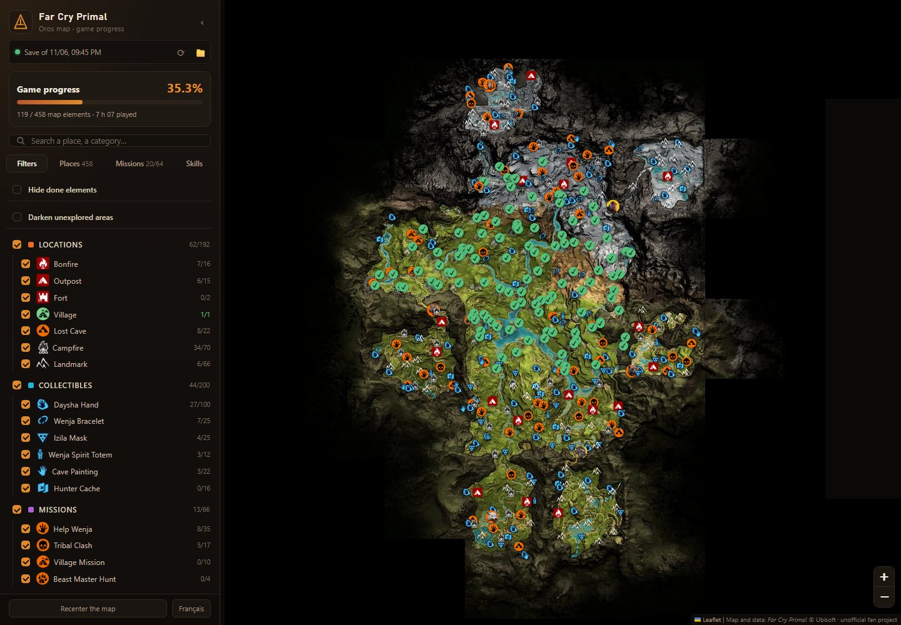

# Far Cry Primal Interactive Map & 100% Completion Tracker

**Oros Map** is a free interactive map of Far Cry Primal that **reads your save file** and ticks off
everything you have done: collectibles picked up, bonfires and outposts taken, caves and places
discovered, missions completed, skills learned and crafting upgrades made. Nothing to tick by hand —
keep the map open on a second screen and it updates every time the game saves. It is the quickest way
to find the last Daysha hands, Wenja bracelets or Izila masks you need for 100%.

**[Open the online map](https://programgames.github.io/far-cry-primal-map/)** — it works in any browser,
with nothing to install: open your save file to see your progress. For a map that updates by itself
while you play, use the free Windows app below.

> Unofficial fan project, not affiliated with or endorsed by Ubisoft.
> Far Cry Primal and all its content (map, texts, icons) are the property of Ubisoft Entertainment.

## Download and start (Windows)

1. Download **`OrosMap-x.y.z-windows.zip`** from the [latest release](../../releases/latest).
2. Unzip the whole file into any folder (right-click → *Extract All…*).
3. Double-click **`OrosMap.exe`**. The map opens in your web browser.
4. Leave the black window open while you use the map; close it to stop the map.

Nothing to install: the download contains everything it needs. If Windows shows
*"Windows protected your PC"*, click **More info → Run anyway** (the app is free and not signed).

Full help: see the [wiki](../../wiki).

## What it shows

- **Map**: the game's own world map of Oros, with every element at its exact position from the game
  data (see the table below).
- **Your progress**: what is done is greyed out with a green tick. Option: *hide what is done*, to see
  only what is left.
- **Fog of war**: option to darken the areas you have never explored (read from your save).
- **Missions** tab: the 64 story and side missions, grouped by story line (Sayla, Tensay, Wogah…),
  with a button to show the mission giver on the map.
- **Skills** tab: the 80 skills by skill tree, and the 55 crafting upgrades.
- **Summary**: game progress (%) and play time, as the game reports them.
- **Animal areas**: where to hunt the 20 animal species (mammoth, sabretooth tiger, cave bear, woolly
  rhino, cave lion…).

| Collectibles | Total | Locations | Total | Activities | Total |
| --- | --: | --- | --: | --- | --: |
| Daysha hands | 100 | Bonfires | 16 | Help Wenja | 35 |
| Wenja bracelets | 25 | Outposts | 15 | Tribal clashes | 17 |
| Izila masks | 25 | Forts | 2 | Village missions | 10 |
| Wenja spirit totems | 12 | Lost caves | 22 | Beast Master hunts | 4 |
| Cave paintings | 22 | Campfires | 70 | | |
| Hunter caches | 16 | Landmarks | 66 | | |

The interface is in English and French. It follows the language of your browser; the **English** /
**Français** button at the bottom of the side panel changes it.

## FAQ

### Where is the Far Cry Primal save file?

All PC versions (Ubisoft Connect, Steam, Epic) keep the save in the Ubisoft Connect folder, usually
`C:\Program Files (x86)\Ubisoft\Ubisoft Game Launcher\savegames\<numbers>\2010\`. The last number can
be different for the Steam and Epic versions. Oros Map finds the save by itself on every drive. If it
cannot, click **📁** in the app and choose the folder.

### How do I find the collectibles I am missing?

Tick **Hide done elements**: the map then shows only what you have not found yet. The **Places** tab
lists the elements still to do first; click one to go to it on the map.

### What do I still need for 100%?

The side panel shows the same progress % as the game menu, and a count per category (for example
*Daysha Hand 27/100*). Hide the done elements to see what is left for each category.

### Is it a save editor? Can it break my save?

No. Oros Map is a save viewer: it only **reads** the save file and never changes it. Nothing leaves your
PC (the only network request is an optional check for a new version on GitHub). The online map reads
the file in your browser: the file is not sent anywhere.

### Does it work on PS4, Xbox or Steam Deck?

The [online map](https://programgames.github.io/far-cry-primal-map/) works on any device, as a plain
map with every location. To show your progress, it needs the save file of the PC version: it cannot
read PS4 or Xbox saves.

## En français

**Carte interactive de Far Cry Primal et suivi de la progression à 100 %.** Oros Map lit votre
sauvegarde et coche tout ce que vous avez fait : mains daysha, bracelets wenja, masques izila,
esprits-totems, peintures rupestres, caches de chasseur, bûchers, avant-postes, grottes perdues et
missions. L'interface est en français si votre navigateur est en français.
[Ouvrez la carte en ligne](https://programgames.github.io/far-cry-primal-map/) et choisissez votre
fichier de sauvegarde. Pour une carte qui se met à jour pendant que vous jouez, téléchargez
**`OrosMap-x.y.z-windows.zip`** dans la [dernière version](../../releases/latest), décompressez-le, puis
double-cliquez sur **`OrosMap.exe`**.

## For developers

- Runtime: Node.js 22.2+, no npm dependency. `node server.js --open` serves the app on
  `http://localhost:4173`. `node lib/save.js` checks that your save can be read.
- `node tools/package.js` builds `dist/OrosMap/` and the release zip (launcher compiled with the C#
  compiler that ships with Windows, plus a copy of `node.exe`).
- Game data in `data/` is pre-built from files extracted from the game, with the scripts in
  `tools/game/` (`build_data.py`, `build_icons.py`, `build_tiles.py`, Python 3 + Pillow). Building it
  again needs your own extraction of the game files; see the docstrings of those scripts.
- How the save format was decoded: [`docs/save-format.md`](docs/save-format.md). The reader,
  [`public/savefile.js`](public/savefile.js), runs in Node (local server) and in the browser (online map).
- Online map: `.github/workflows/pages.yml` publishes `public/`, `data/` and `tiles/` to GitHub Pages on
  every push to `main`. Without the local server, the page asks for the save file.

| Method | Route | Description |
| --- | --- | --- |
| `GET` | `/api/progress` | state of every map element, missions, skills, crafting, progress, play time |
| `GET` | `/api/fog` | fog of war: raw 1024 × 1024 bit grid |
| `POST` | `/api/save-location/pick` | Windows folder dialog to choose the save folder |
| `POST` | `/api/save-location/auto` | back to automatic search |
| `GET` | `/api/update` | newer release on GitHub? |

The server only listens on `127.0.0.1`.

## License

Source code: [MIT](LICENSE). Game content: © Ubisoft.
